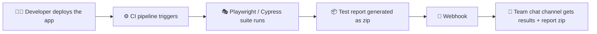
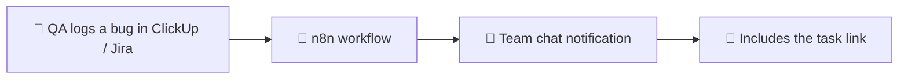

<!-- ============================================= HEADER ============================================== -->

 

  

---

## 👨‍💻 About Me

I'm a **QA Engineer with 1.6 years of dedicated QA experience**, built on top of **about 2 years as a Software Developer**. That development background means I read code, debug at the source, and talk to developers in their language.

My QA work covers **both manual testing and test automation**. Manual testing is a real specialty of mine: test planning, exploratory testing, UAT, defect tracking, and RBAC/access-control validation. I then automate the high-value flows with Playwright, Cypress, and Robot Framework so teams get fast, trustworthy feedback on every build.

I've tested **AI-powered CRM, blockchain, healthcare, education, and AI image-generation** products.

| 📌 At a Glance | Details |
| :-- | :-- |
| 🧑‍💼 **Role** | QA Engineer @ Twist Digital |
| 🧪 **QA Experience** | 1.6 years (dedicated QA, manual + automation) |
| 💻 **Developer Experience** | ~2 years |
| 📍 **Location** | Sri Lanka |
| 🎯 **Focus** | Manual testing (test design, exploratory, UAT, defect management) Web & mobile automation (Playwright, Cypress, Robot Framework + Appium) CI/CD-integrated testing with automated webhook reporting AI agents & AI-assisted testing API, performance, security & RBAC validation |
| 📚 **Currently Learning** | AI-driven test generation, advanced CI pipelines |
| 💬 **Ask Me About** | Test automation, RBAC testing, JMeter load tests, n8n workflows |

---

## 🛠️ Tech Stack

**🧪 Automation & Testing**

**🔌 API & Performance**

**💻 Languages & Databases**

**⚙️ CI/CD, Workflow & Collaboration**

### 🎯 Testing Expertise

| Area                     | What I Do                                                         |
| ------------------------ | ----------------------------------------------------------------- |
| 🧪 **Manual Testing & UAT** | Test plans, test cases, exploratory testing, regression, defect tracking, stakeholder UAT |
| 🌐 **Web Automation**    | End-to-end and regression suites with Playwright & Cypress        |
| 🤖 **AI-Assisted QA**    | AI agents to speed up test creation and execution                 |
| 📱 **Mobile Automation** | Android/iOS flows with Robot Framework + Appium                   |
| 🔌 **API Testing**       | Functional and integration checks with Postman                    |
| ⚡ **Performance**       | Load and concurrency testing with JMeter                          |
| 🔐 **Security & RBAC**   | Role/permission matrices and access-control validation            |

---

## 🔄 How I Automate Quality

**1️⃣ Automated test reporting after every deployment**

**2️⃣ Instant bug notifications with n8n**

Right after a deployment, the team's chat channel receives the test results along with the full report zip through a webhook, with no manual step. When QA raises a bug in the project management tool, an n8n workflow notifies the team in chat with a direct link to the task, so nothing gets missed.

---

## 💼 Experience

**🧪 QA experience: 1.6 years** (Twist Digital, manual + automation) · **💻 Developer experience: ~2 years** (Shiftx Global, Binary Technologies)

| Role                                       | Company                      | Period              |
| ------------------------------------------ | ---------------------------- | ------------------- |
| 🥇 **QA Engineer**                         | Twist Digital, Colombo       | Dec 2025 – Present  |
| **Junior QA Engineer**                     | Twist Digital, Colombo       | May 2025 – Nov 2025 |
| **Associate Software Engineer (QA & Dev)** | Shiftx Global, Colombo       | Apr 2024 – Jan 2025 |
| **Associate Software Engineer (QA & Dev)** | Binary Technologies, Colombo | Feb 2023 – Mar 2024 |

**Recent highlights at Twist Digital**

- 🎭 Built and maintained Cypress/Playwright automation, ensuring data integrity in sandbox environments
- ⚙️ Integrated Playwright into CI so tests auto-trigger on every build, with results and the report zip sent to the team chat via webhook
- 🧪 Implemented end-to-end CI testing that improved release confidence and caught regressions early
- 📱 Automated Android/iOS testing with Robot Framework and Appium
- 🤖 Applied AI agents and AI-assisted testing to speed up test creation and execution
- 🔔 Used n8n to notify the team in chat about newly logged bugs, with a direct link to the task in ClickUp/Jira
- 📈 Led API, performance, and UAT testing to improve stability and speed up bug resolution

---

## 🚀 Key Projects

> Most of my project work is on private, client-owned products, so these are summaries of what I tested and automated.

<table>
<tr>
<td width="50%" valign="top">

### 🤖 AI-Powered CRM Platform

_Conversational AI, call intelligence & scheduling_

- Tested AI chatbot, automated calling, call transcription, and calendar/event modules
- Automated regression with Playwright
- Validated RBAC across user roles
- Load-tested lead-capacity limits with JMeter

`Cypress` `Playwright` `JMeter` `Postman` `RBAC`

</td>
<td width="50%" valign="top">

### 👗 AI Image Generation & Virtual Try-On

_Image generation from user photos and garments_

- Tested AI try-on and image-generation flows
- Built a CI-integrated Playwright workflow triggered on build release, with team-channel reporting
- Load-tested parallel generation from multiple devices

`Playwright` `JMeter` `CI/CD` `Automated Reporting`

</td>
</tr>
<tr>
<td width="50%" valign="top">

### 🎓 Educational Platform

_Admin portal + Student & Guardian mobile apps_

- Tested the admin portal and native mobile apps
- Built Robot Framework automation with clear, readable flows for non-technical review

`Robot Framework` `Appium` `Manual & UAT`

</td>
<td width="50%" valign="top">

### 🏥 Clinic Management System

_Patients, appointments, check-in & medicine inventory_

- Tested end-to-end clinic workflows
- Mapped and maintained an RBAC matrix across user types, with documentation

`Manual Testing` `RBAC Mapping` `Documentation`

</td>
</tr>
</table>

---

## 🎓 Education & Certifications

<table>
<tr>
<td valign="top" width="50%">

**🏅 Certifications**

- ISTQB® Foundation Level (May 2026)
- Certificate of Software Test Automation, Imperial College of IT & Business (May 2025)
- Test Automation Foundations, Understanding Manual Testing, API Testing Foundations (LinkedIn Learning)

</td>
<td valign="top" width="50%">

**🎓 Education**

- BSc (Hons) Computer Science & Software Engineering, University of Bedfordshire, UK
- HND in Information Technology, SLIIT Academy

</td>
</tr>
</table>

---

## 📊 GitHub Stats

---

## 🤝 Let's Connect

I'm open to **QA roles (manual and automation) and collaborations**. Happy to chat about test strategy, manual and automated testing, CI/CD testing, and using AI to make QA smarter.

  

_"Quality is not an act, it is a habit."_

