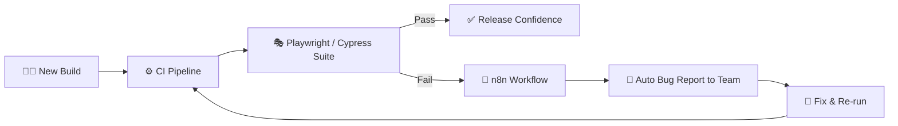

<!-- ===================== HEADER ===================== -->
<div align="center">


<a href="https://git.io/typing-svg">
  
</a>

<br>


<br><br>

<a href="https://www.linkedin.com/in/rushanthang"></a>
<a href="mailto:m.g.rushanthan@gmail.com"></a>
<a href="https://github.com/RushanthanGunalan"></a>

</div>

---

## 👨‍💻 About Me

I'm a **QA Engineer with 3+ years of technical experience**: about 2 years as a Software Engineer (development + testing), followed by over a year fully focused on **QA and test automation**. That dev background means I read code, debug at the source, and talk to developers in their language.

I've tested **AI-powered CRM, blockchain, healthcare, education, and AI image-generation** products, and I enjoy building automation that gives teams fast, trustworthy feedback on every build.

```yaml
name: Rushanthan Gunalan
role: QA Engineer @ Twist Digital
location: Sri Lanka 🇱🇰
focus:
  - Web & mobile test automation (Playwright, Cypress, Robot Framework + Appium)
  - CI/CD-integrated testing on every build
  - AI agents & AI-assisted testing
  - API, performance, security & RBAC validation
currently_learning: [AI-driven test generation, advanced CI pipelines]
ask_me_about: [Test automation, RBAC testing, JMeter load tests, n8n workflows]
```

---

## 🛠️ Tech Stack

<div align="center">

**Automation & Testing**

<br>


**Languages & Databases**


**CI/CD, Workflow & Collaboration**

<br>


</div>

### 🎯 Testing Expertise

| Area                     | What I Do                                                         |
| ------------------------ | ----------------------------------------------------------------- |
| 🌐 **Web Automation**    | End-to-end and regression suites with Playwright & Cypress        |
| 🤖 **AI-Assisted QA**    | AI agents to speed up test creation and execution                 |
| ✅ **Manual & UAT**      | Test plans, exploratory testing, defect tracking, stakeholder UAT |
| 📱 **Mobile Automation** | Android/iOS flows with Robot Framework + Appium                   |
| 🔌 **API Testing**       | Functional and integration checks with Postman                    |
| ⚡ **Performance**       | Load and concurrency testing with JMeter                          |
| 🔐 **Security & RBAC**   | Role/permission matrices and access-control validation            |

---

## 🔄 How I Automate Quality



Every build auto-triggers tests, and failed runs are reported to the team automatically, so defects get communicated in minutes instead of hours.

---

## 💼 Experience

| Role                                       | Company                      | Period              |
| ------------------------------------------ | ---------------------------- | ------------------- |
| 🥇 **QA Engineer**                         | Twist Digital, Colombo       | Dec 2025 – Present  |
| **Junior QA Engineer**                     | Twist Digital, Colombo       | May 2025 – Nov 2025 |
| **Associate Software Engineer (QA & Dev)** | Shiftx Global, Colombo       | Apr 2024 – Jan 2025 |
| **Associate Software Engineer (QA & Dev)** | Binary Technologies, Colombo | Feb 2023 – Mar 2024 |

**Recent highlights at Twist Digital**

- 🎭 Built and maintained Cypress/Playwright automation, ensuring data integrity in sandbox environments
- ⚙️ Integrated Playwright into CI so tests auto-trigger on every build for faster feedback
- 🧪 Implemented end-to-end CI testing that improved release confidence and caught regressions early
- 📱 Automated Android/iOS testing with Robot Framework and Appium
- 🤖 Applied AI agents and AI-assisted testing to speed up test creation and execution
- 🔔 Used n8n to auto-report bugs from failed test runs
- 📈 Led API, performance, and UAT testing to improve stability and speed up bug resolution

---

## 🚀 Key Projects

> Most of my project work is on private, client-owned products, so these are summaries of what I tested and automated.

<table>
<tr>
<td width="50%" valign="top">

### 🤖 AI-Powered CRM Platform

_Conversational AI, call intelligence & scheduling_

- Tested AI chatbot, automated calling, call transcription, and calendar/event modules
- Automated regression with Playwright
- Validated RBAC across user roles
- Load-tested lead-capacity limits with JMeter

`Playwright` `Cypress` `JMeter` `Postman` `RBAC`

</td>
<td width="50%" valign="top">

### 👗 AI Image Generation & Virtual Try-On

_Image generation from user photos and garments_

- Tested AI try-on and image-generation flows
- Built a CI-integrated Playwright workflow triggered on build release, with team-channel reporting
- Load-tested parallel generation from multiple devices

`Playwright` `JMeter` `CI/CD` `Automated Reporting`

</td>
</tr>
<tr>
<td width="50%" valign="top">

### 🎓 Educational Platform

_Admin portal + Student & Guardian mobile apps_

- Tested the admin portal and native mobile apps
- Built Robot Framework automation with clear, readable flows for non-technical review

`Robot Framework` `Appium` `Manual & UAT`

</td>
<td width="50%" valign="top">

### 🏥 Clinic Management System

_Patients, appointments, check-in & medicine inventory_

- Tested end-to-end clinic workflows
- Mapped and maintained an RBAC matrix across user types, with documentation

`Manual Testing` `RBAC Mapping` `Documentation`

</td>
</tr>
</table>

---

## 🎓 Education & Certifications

<table>
<tr>
<td valign="top" width="50%">

**🏅 Certifications**

- ISTQB® Foundation Level (May 2026)
- Certificate of Software Test Automation, Imperial College of IT & Business (May 2025)
- Test Automation Foundations, Understanding Manual Testing, API Testing Foundations (LinkedIn Learning)

</td>
<td valign="top" width="50%">

**🎓 Education**

- BSc (Hons) Computer Science & Software Engineering, University of Bedfordshire, UK
- HND in Information Technology, SLIIT Academy

</td>
</tr>
</table>

---

## 📊 GitHub Stats

<div align="center">


</div>

---

## 🤝 Let's Connect

I'm open to **QA automation roles and collaborations**. Happy to chat about test automation, CI/CD testing, and using AI to make QA smarter.

<div align="center">

<a href="https://www.linkedin.com/in/rushanthang"></a>
<a href="mailto:m.g.rushanthan@gmail.com"></a>

<br><br>

_"Quality is not an act, it is a habit."_


</div>
